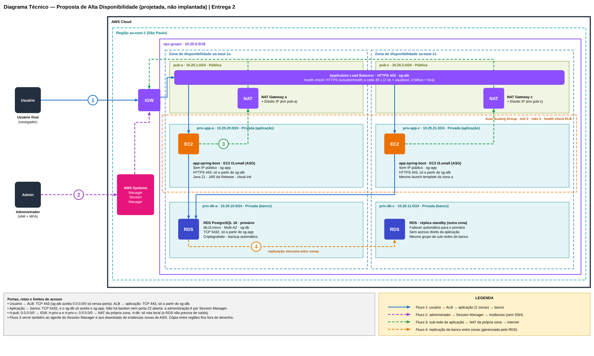

# Alta disponibilidade (Entrega 2, Parte C)

Esta é uma proposta **apenas projetada**: não foi implantada e não existe código Terraform dela. Ela parte da arquitetura da Entrega 1 (`docs/arquitetura.md`) e trata cada ponto único de falha da seção 5.10 daquele documento.

Diagrama: `docs/diagramas/arquitetura-ha.png` (fonte editável: `arquitetura-ha.drawio`). A versão da Entrega 1 continua em `docs/diagramas/arquitetura.png` para comparação.

**Alta disponibilidade não é backup.** A proposta mantém o sistema no ar quando uma instância ou uma zona falha. Ela não protege contra um erro lógico: se alguém apagar uma tabela, o standby do banco apaga a mesma tabela segundos depois. Esse caso é coberto pelo plano de `docs/backup.md`.

## Resumo das decisões

| Tema | Decisão |
|---|---|
| Zonas (H1) | `sa-east-1a` e `sa-east-1c`, em todos os níveis |
| Entrada e balanceamento (H2) | Application Load Balancer (ALB) com HTTPS, na frente de um grupo de autoescalonamento (ASG) de 2 a 4 instâncias |
| Saída para a internet (H3) | Um NAT Gateway por zona |
| Banco (H4) | Amazon RDS for PostgreSQL Multi-AZ, com standby em outra zona e failover automático |
| Estado (H5) | Aplicação sem estado local; o único dado persistente está no banco |
| Pontos únicos de falha (H6) | 5 eliminados, 1 reduzido (T3) e 1 tratado em parte (HTTPS resolvido, falta de login aceita com justificativa); ver seção H6 |
| Acesso administrativo (H7) | Session Manager (AWS Systems Manager), sem bastion e sem porta 22 |
| Custo | **+112%** sobre o Cenário A (seção "Custo") |

## H1. Zonas e plano de endereçamento

Todos os níveis usam duas zonas. A VPC continua em 10.20.0.0/16. As faixas 10.20.2.0/24 e 10.20.11.0/24 já estavam reservadas na Entrega 1 para esta finalidade.

| Sub-rede | CIDR | Zona | Tipo | Conteúdo |
|---|---|---|---|---|
| `pub-a` | 10.20.1.0/24 | sa-east-1a | Pública | ALB (nó da zona), NAT Gateway a |
| `pub-c` | 10.20.2.0/24 | sa-east-1c | Pública | ALB (nó da zona), NAT Gateway c |
| `priv-app-a` | 10.20.20.0/24 | sa-east-1a | Privada | Instâncias da aplicação (ASG) |
| `priv-app-c` | 10.20.21.0/24 | sa-east-1c | Privada | Instâncias da aplicação (ASG) |
| `priv-db-a` | 10.20.10.0/24 | sa-east-1a | Privada | RDS (primário ou standby) |
| `priv-db-c` | 10.20.11.0/24 | sa-east-1c | Privada | RDS (standby ou primário) |

Em relação à Entrega 1: `pub-a` e `priv-a` continuam com os mesmos CIDRs (`priv-a` passa a se chamar `priv-db-a`), e a aplicação **sai da sub-rede pública** e passa a ficar em sub-redes privadas, porque agora quem recebe o tráfego da internet é o ALB. As faixas não se sobrepõem e continuam dentro da faixa privada 10.20.0.0/16.

**Tabelas de rota**

| Tabela | Associada a | Rotas |
|---|---|---|
| `rt-pub` | `pub-a`, `pub-c` | 10.20.0.0/16 → local; 0.0.0.0/0 → Internet Gateway |
| `rt-priv-a` | `priv-app-a` | 10.20.0.0/16 → local; 0.0.0.0/0 → NAT Gateway a |
| `rt-priv-c` | `priv-app-c` | 10.20.0.0/16 → local; 0.0.0.0/0 → NAT Gateway c |
| `rt-db` | `priv-db-a`, `priv-db-c` | 10.20.0.0/16 → local (**sem rota para a internet**) |

Como o RDS é gerenciado, ele não precisa baixar pacotes. As sub-redes de banco ficam sem nenhuma saída, o que reduz a superfície em relação à Entrega 1, onde o banco saía pelo NAT.

**Grupos de segurança**

| Grupo | Entrada | Saída |
|---|---|---|
| `sg-alb` | TCP 443 de 0.0.0.0/0 | TCP 443 para `sg-app` |
| `sg-app` | TCP 443 de `sg-alb` | TCP 5432 para `sg-db`; TCP 80/443 para 0.0.0.0/0 (pacotes, JAR, agente do Session Manager); DNS para o resolvedor da VPC |
| `sg-db` | TCP 5432 de `sg-app` | Nenhuma |

Não existe regra de SSH em nenhum grupo.

## H2. Balanceador de carga e autoescalonamento

| Item | Configuração |
|---|---|
| Balanceador | Application Load Balancer (internet-facing), nas sub-redes `pub-a` e `pub-c`, grupo `sg-alb` |
| Listener | HTTPS 443. No laboratório, certificado autoassinado importado no ACM; em produção, certificado público do ACM com domínio próprio |
| Destino | Target group HTTPS 443 (a aplicação continua servindo por TLS, então o tráfego entre ALB e instância segue criptografado) |
| **Health check** | `GET https://<instância>:443/actuator/health`, esperando HTTP 200; intervalo de **30 s**; **2 verificações bem-sucedidas** para ficar saudável; **3 falhas** para sair de rotação |
| Grupo de autoescalonamento | Mínimo **2**, desejado **2**, máximo **4**, nas sub-redes `priv-app-a` e `priv-app-c`, com tipo de health check **ELB** |
| Launch template | Mesma instância da Entrega 2 (t3.small, Ubuntu 24.04, disco criptografado, IMDSv2 obrigatório, `user_data` que instala a aplicação) |
| Política de escala | Rastreamento de CPU em 60%, apenas para absorver picos até 4 instâncias |

Com o health check do tipo ELB, o ASG substitui sozinho a instância que o balanceador considerar não saudável. Com mínimo 2 e distribuição entre as zonas, uma instância fica em cada zona em operação normal.

## H3. Estratégia de NAT

**Decisão: um NAT Gateway por zona.** Cada sub-rede de aplicação usa o NAT da própria zona (`rt-priv-a` e `rt-priv-c`).

| Alternativa | Vantagem | Consequência |
|---|---|---|
| **Um NAT por zona (escolhida)** | A falha de uma zona não afeta a saída da outra | Custo duas vezes maior de NAT (**+US$ 64,24 por mês** na rede, ver "Custo") |
| NAT compartilhado | Metade do custo de NAT | Se a zona do NAT cair, a zona sobrevivente perde a saída: instâncias novas do ASG não conseguem instalar pacotes nem baixar o JAR, e o agente do Session Manager perde a conexão. Reintroduz um ponto único de falha por zona, contrariando H1. Haveria também tráfego entre zonas |

Por que a saída importa mesmo sem usuário usando: o tráfego de usuários **não** passa pelo NAT (entra pelo ALB), mas a **recuperação** passa. Quando uma zona cai, o ASG precisa criar instâncias novas na zona sobrevivente, e esse processo baixa pacotes e o JAR pela internet.

Uma forma de reduzir essa dependência seria uma imagem de máquina (AMI) pré-pronta, que dispensa a instalação no boot. Ela não faz parte desta proposta (ver "Pontos que continuam").

## H4. Estratégia para o banco

**Decisão: Amazon RDS for PostgreSQL em Multi-AZ** (db.t3.micro, 20 GB gp3, criptografado), com o standby em `priv-db-c`.

| Opção | Avaliação |
|---|---|
| **RDS Multi-AZ (escolhida)** | Réplica síncrona em outra zona e failover automático, sem o grupo operar a replicação. Backups automáticos e atualizações de versão pelo serviço. Custo maior que uma instância EC2 (US$ 64,24 contra US$ 15,30 por mês) |
| Réplica própria em EC2 (PostgreSQL com replicação) | Mais barata (cerca de uma segunda t3.micro), mas o grupo teria de instalar, monitorar e promover a réplica à mão, e o failover não seria automático. Para uma proposta cujo objetivo é eliminar o ponto único de falha, a promoção manual manteria uma dependência de pessoas |
| Manter uma instância e confiar em backup | É a política mínima da Entrega 2. Aceita indisponibilidade de até o RTO de 4 horas |

**Revisão do ADR-003.** Na Entrega 1 o RDS foi descartado porque exigia sub-redes em duas zonas e custava mais. A proposta tem duas zonas, então esse impedimento deixa de existir; o custo continua sendo o motivo contra, e é tratado na seção "Custo". A decisão da arquitetura **implantada** continua sendo a do ADR-003; esta proposta é um novo ADR (ver `docs/adr/`).

**Efeito no backup.** Com o RDS, a geração diária (Son) passa a ser o backup automático do serviço. As gerações semanal e mensal precisariam de snapshots manuais agendados ou do AWS Backup. O custo do backup com RDS **não foi recalculado** e não está na tabela de `docs/backup.md`, que se refere ao disco EBS.

## H5. Estado fora da instância

| Tipo de estado | Onde fica |
|---|---|
| Sessões de usuário | **Não existem**: a aplicação não tem login nem sessão. Se um login fosse adicionado, as sessões iriam para o banco (Spring Session com JDBC), nunca para a memória da instância |
| Arquivos enviados | **Não existem**: a aplicação só grava nome e quantidade |
| Dados dos produtos | RDS (único estado persistente) |
| Configuração e segredos | Variáveis do launch template e do Terraform; nada é gravado só na instância |
| Código da aplicação | JAR na Release do repositório, baixado no boot |
| Estado do Terraform | Em produção, backend remoto versionado e criptografado (hoje é um arquivo local) |

Como nenhuma instância guarda estado, qualquer uma atende qualquer requisição, e o ASG pode destruir e recriar instâncias a qualquer momento sem perda de dados.

## H6. Tratamento dos pontos únicos de falha (seção 5.10 da Entrega 1)

| # | Ponto único de falha da Entrega 1 | Tratamento | Situação |
|---|---|---|---|
| 1 | Todos os recursos em uma só zona | Duas zonas em todos os níveis (sub-redes, ALB, ASG, NAT, RDS) | **Eliminado** para falha de zona. Falha da região inteira continua possível e é aceita |
| 2 | Banco em uma única instância, sem réplica e sem backup | RDS Multi-AZ com standby em outra zona e failover automático, mais o plano de backup | **Eliminado** como ponto único. Erro lógico depende do backup |
| 3 | Aplicação em uma instância, sem balanceador | ALB com ASG de no mínimo 2 instâncias em duas zonas e health check | **Eliminado** |
| 4 | NAT Gateway único | Um NAT por zona, cada sub-rede de aplicação usa o da própria zona | **Eliminado** |
| 5 | Bastion único e regra SSH presa ao IP do grupo | Bastion removido. Acesso por Session Manager (IAM e MFA), sem porta 22 e sem dependência do IP de origem | **Eliminado**. O acesso passa a depender do serviço Systems Manager da AWS e de uma função IAM mínima nas instâncias (`AmazonSSMManagedInstanceCore`), que substitui a regra "nenhuma instância tem papel" da Entrega 2 |
| 6 | Acesso por HTTP, sem HTTPS e sem login | **HTTPS:** o ALB termina TLS (443) e re-criptografa para as instâncias. **Login:** não tratado | HTTPS **eliminado**. Falta de login **aceita**: uso interno e sem dados pessoais, e o `sg-alb` poderia ser restrito ao CIDR da empresa. Em produção, adicionar autenticação (Spring Security ou OIDC no ALB) |
| 7 | Capacidade limitada das instâncias T3 (créditos de CPU) | Duas instâncias dividem a carga, e o ASG sobe até 4 com a CPU acima de 60%. Alarme sobre `CPUCreditBalance` | **Reduzido**. O modo `unlimited` evitaria a limitação, mas gera cobrança adicional por crédito excedente |

## H7. Fluxos numerados na nova arquitetura

Os fluxos 1, 2 e 3 são os da Entrega 1, redesenhados. O fluxo 4 é novo.

| Fluxo | Entrega 1 | Proposta de alta disponibilidade |
|---|---|---|
| 1 | Usuário → IGW → aplicação (TCP 8080) → banco (5432) | Usuário → IGW → **ALB** (HTTPS 443, nas duas zonas) → **instância da aplicação em `a` ou `c`** (HTTPS 443, só do `sg-alb`) → **RDS primário** (5432, só do `sg-app`) |
| 2 | Administrador (IP do grupo) → IGW → bastion (22) → aplicação e banco (22) | Administrador (IAM e MFA) → **Session Manager** (HTTPS) → agente nas instâncias da aplicação. **Sem bastion e sem SSH.** O agente abre a conexão de dentro, pela saída do fluxo 3 |
| 3 | Banco (sub-rede privada) → NAT Gateway → IGW → internet | Sub-rede de aplicação → **NAT Gateway da própria zona** → IGW → internet (pacotes, JAR, agente do Session Manager). O banco não usa mais este fluxo |
| 4 | Não existia | RDS primário → standby em outra zona, replicação síncrona gerenciada pelo serviço |

O ALB também envia a cada instância o health check descrito em H2.

**Comportamento em uma falha da zona `a` (previsto, não testado).**

1. O ALB deixa de receber resposta do health check das instâncias da zona `a`, e após 3 falhas de 30 s (cerca de 90 s) tira essas instâncias de rotação. Os usuários passam a ser atendidos pela instância da zona `c`.
2. O ASG cria uma instância de reposição na zona `c`, que usa o NAT da zona `c` para instalar a aplicação.
3. Se o primário do RDS estava na zona `a`, o serviço promove o standby da zona `c`. O endereço do banco não muda. A duração do failover deve ser confirmada na documentação da AWS.

## Pontos que continuam

A proposta não elimina tudo. Permanecem:

| Ponto | Observação |
|---|---|
| Falha da região `sa-east-1` | Exigiria uma segunda região, fora do escopo |
| Fonte do JAR (Release do GitHub) | Se o GitHub estiver fora do ar, instâncias novas não instalam a aplicação. Uma AMI pré-pronta ou uma cópia do JAR em um bucket resolveria |
| Estado do Terraform local | Hoje existe uma única cópia, no computador de quem aplica |
| Erro humano ou lógico nos dados | Só o backup cobre (ver `docs/backup.md`) |
| Falhas dos serviços gerenciados (ALB, IGW, RDS, Systems Manager) | São redundantes por desenho da AWS, mas continuam sendo uma dependência |

## Custo

**Fonte:** Calculadora de Preços da AWS, região América do Sul (São Paulo), sob demanda, 730 horas por mês. O PDF das linhas ALB e RDS está em `docs/custos/` (ALB: US$ 25,14; RDS: US$ 64,24). As demais linhas usam os preços unitários já confirmados na Entrega 1 (`docs/arquitetura.md`, seção 5.9).

### Comparação com o Cenário A

| Versão | Custo mensal estimado | Variação |
|---|---|---|
| Arquitetura implantada (Entrega 1, cenário A) | US$ 134,14 | - |
| Proposta de alta disponibilidade | **US$ 285,03** | **+112%** (+US$ 150,89 por mês, +US$ 1.810,68 por ano) |

### Composição da proposta

| Item | Cálculo | US$/mês | Entrega 1 (US$/mês) | Diferença |
|---|---|---|---|---|
| Aplicação | 2 × t3.small (730 h) com EBS de 10 GB: 2 × 26,05 | 52,10 | 26,05 | **+26,05** |
| Bastion | Removido (Session Manager não tem cobrança adicional) | 0,00 | 13,48 | **−13,48** |
| Banco | RDS PostgreSQL Multi-AZ db.t3.micro, 20 GB gp3 (calculadora) | 64,24 | 15,30 | **+48,94** |
| Balanceador | Application Load Balancer (calculadora) | 25,14 | 0,00 | **+25,14** |
| Rede | 2 NAT Gateways: horas 2 × 67,89 = 135,78 e 5 GB = 0,47; 2 IPv4 dos NAT: 2 × 3,65 = 7,30 | 143,55 | 79,31 | **+64,24** |
| **Total** | | **285,03** | **134,14** | **+150,89** |

**Premissas e limites da estimativa.**

- O ALB foi estimado com 1 GB por mês de dados processados. O custo vem quase todo da taxa fixa por hora.
- Se os endereços IPv4 públicos do ALB (um por zona) forem cobrados à parte da linha do ALB, o total subiria até US$ 7,30 por mês (2 × 3,65). Não foi possível confirmar na calculadora se eles já estão incluídos.
- Não foram incluídos: tráfego entre zonas, certificado e domínio próprio, CloudWatch além do básico, armazenamento de backup do RDS acima do tamanho do banco, e o custo de escalar acima de 2 instâncias (a estimativa assume o mínimo).
- O RDS foi estimado sem RDS Proxy e sem Database Insights, que a proposta não usa.

### O que mais contribui para o aumento

| Item | Aumento (US$/mês) | Parte do aumento |
|---|---|---|
| Rede: segundo NAT Gateway | +64,24 | 43% |
| Banco: RDS Multi-AZ no lugar da EC2 | +48,94 | 32% |
| Aplicação: segunda instância | +26,05 | 17% |
| Balanceador de carga | +25,14 | 17% |
| Bastion removido | −13,48 | −9% |

O NAT é o maior item, como já era o maior da Entrega 1. Cobra por hora, mesmo sem tráfego, e dobrar a quantidade dobra a conta.

### Alternativa mais barata

Mantendo **um único NAT compartilhado** (descrito em H3), o total seria US$ 213,49 por mês (**+59%**): rede de US$ 72,01 (NAT 68,36 e 1 IPv4 de 3,65) no lugar de US$ 143,55. Em troca, uma falha da zona do NAT deixaria a outra zona sem saída para a internet, e a recuperação automática dependeria dela.

### O custo se justifica para o perfil de uso?

**Não, para o perfil descrito na Entrega 1 (seção 5.1).**

- **Uso e criticidade.** É um cadastro interno de estoque, para até 10 usuários simultâneos, sem pedidos de clientes em tempo real. O grupo já aceitou, em `docs/backup.md`, um RPO de 24 horas e um RTO de 4 horas. Uma indisponibilidade dentro dessa janela não gera um prejuízo que o grupo saiba quantificar, porque o estoque pode ser conferido na contagem física.
- **Proporção.** A proposta mais que dobra o custo (+US$ 150,89 por mês, +US$ 1.810,68 por ano) para evitar interrupções que o uso real tolera. O ganho é o de uma falha de zona ou de instância não parar o sistema, e esses eventos são raros.
- **O que o grupo faria.** Operaria a arquitetura da Entrega 1 com a política de backup de `docs/backup.md` (custo de backup de US$ 21,01 em 12 meses para a política GFS), e recriaria o ambiente com o Terraform em caso de falha, dentro do RTO de 4 horas.
- **Quando a resposta mudaria.** Se o sistema passasse a ter clientes ou operação em tempo real, ou se uma hora parada passasse a custar mais do que cerca de US$ 150 por mês, o investimento se justificaria. Nesse caso, o caminho em etapas seria: primeiro o banco em Multi-AZ e duas instâncias atrás do ALB com NAT compartilhado (+59%), e só depois o NAT por zona e as demais camadas.
