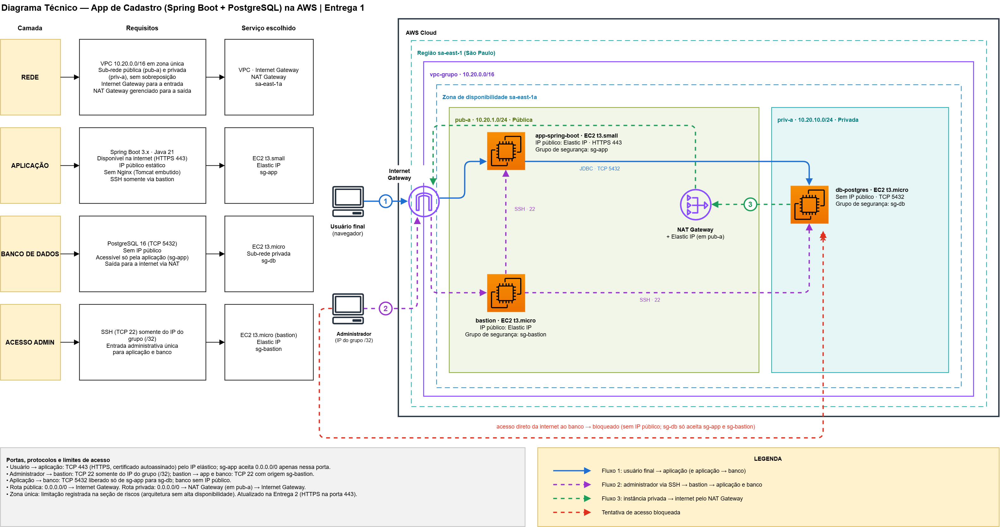

# Arquitetura: Cadastro de Produtos na AWS

Projeto Integrador | Uniamérica Descomplica | Entrega 1

## 5.1 Descrição da aplicação

**Problema.** Pequenos negócios costumam controlar o estoque em planilhas, o que gera erros e versões divergentes. A aplicação oferece um cadastro central de produtos, acessível pelo navegador.

**Usuários.** Funcionários que registram e consultam o estoque (uso interno, perfil único, sem login nesta versão).

**Funcionalidades principais.** Cada produto tem apenas dois campos: nome e quantidade em estoque.

- Criar produto
- Listar produtos
- Editar produto (nome e quantidade)
- Excluir produto

**Componentes técnicos.**

| Componente | Descrição | Exposição |
|---|---|---|
| Aplicação web | Spring Boot (Java 21) com páginas HTML renderizadas no servidor (Thymeleaf). Frontend e backend no mesmo programa, com servidor Tomcat embutido | Pública (TCP 8080) |
| Banco de dados | PostgreSQL 16, tabela `produto` (id, nome, quantidade) | Privada, sem IP público |
| Bastion | Instância apenas para acesso administrativo por SSH | Pública (TCP 22, só do IP do grupo) |

**Atendimento aos requisitos da seção 3 do enunciado.**

| Requisito | Como é atendido |
|---|---|
| Componente acessado pela internet | Aplicação web, na porta 8080 |
| Componente não exposto diretamente | Banco PostgreSQL na sub-rede privada |
| Comportamento verificável com persistência | Criar, listar, editar e excluir produtos; os dados permanecem no PostgreSQL |

**Requisitos não funcionais assumidos.**

- **Carga:** até 10 usuários simultâneos, com poucas requisições por segundo (cadastro de texto curto).
- **Disponibilidade:** esta arquitetura **não oferece alta disponibilidade**. Todos os recursos ficam em uma única zona de disponibilidade e cada componente existe em uma única instância. A disponibilidade esperada é a de um ambiente acadêmico, sem meta de SLA. Os pontos de falha estão listados na seção 5.10.
- **Segurança de transporte:** o acesso é por HTTP na porta 8080, sem HTTPS nesta versão. Isso é uma limitação conhecida, registrada nos riscos.

## 5.2 Diagrama de arquitetura

Arquivo-fonte editável: `docs/diagramas/arquitetura.drawio`. Imagem exportada: `docs/diagramas/arquitetura.png`.

Fluxos numerados do diagrama:

| Fluxo | Caminho |
|---|---|
| 1 | Usuário final → Internet Gateway → IP elástico da aplicação (TCP 8080). A aplicação consulta o banco por TCP 5432 |
| 2 | Administrador (IP do grupo) → Internet Gateway → bastion (TCP 22) → aplicação e banco (TCP 22) |
| 3 | Banco (sub-rede privada) → NAT Gateway (sub-rede pública) → Internet Gateway → internet |

## 5.3 Plano de endereçamento IP

| Recurso | Nome | CIDR | Zona | Tipo | Finalidade |
|---|---|---|---|---|---|
| Rede virtual | `vpc-grupo` | 10.20.0.0/16 | n/a | n/a | Rede do projeto |
| Sub-rede | `pub-a` | 10.20.1.0/24 | sa-east-1a | Pública | Bastion, aplicação, NAT Gateway |
| Sub-rede | `priv-a` | 10.20.10.0/24 | sa-east-1a | Privada | Banco de dados |

Todas as faixas são privadas (RFC 1918) e não se sobrepõem.

**Endereços privados planejados** (fixos no Terraform, para facilitar a Entrega 2):

| Instância | IP privado | IP público |
|---|---|---|
| Bastion | 10.20.1.10 | Elastic IP |
| Aplicação | 10.20.1.20 | Elastic IP |
| Banco | 10.20.10.10 | nenhum |

**Reserva de endereços.** A AWS reserva 5 endereços em cada sub-rede: o primeiro (rede), os três seguintes (roteador da VPC, DNS e uso futuro) e o último (broadcast). Em uma sub-rede /24 sobram 251 endereços utilizáveis.

**Justificativa dos tamanhos.**

- **VPC /16:** o maior bloco permitido pela AWS para uma VPC. Não custa nada e deixa espaço para novas sub-redes na Entrega 2.
- **Sub-redes /24:** cada uma precisa de poucos endereços (3 recursos na pública, 1 na privada), então um /28 bastaria hoje. Escolhemos /24 por ser um padrão fácil de ler e porque a Entrega 2 poderá adicionar recursos, como sub-redes em outra zona (faixas 10.20.2.0/24 e 10.20.11.0/24 ficam reservadas para isso, sem serem criadas agora).

## 5.4 Tabelas de rota

**`rt-pub` (associada à sub-rede `pub-a`)**

| Destino | Alvo | Explicação |
|---|---|---|
| 10.20.0.0/16 | local | Comunicação interna da VPC |
| 0.0.0.0/0 | Internet Gateway | Entrada e saída de tráfego da internet para os recursos com IP público |

**`rt-priv` (associada à sub-rede `priv-a`)**

| Destino | Alvo | Explicação |
|---|---|---|
| 10.20.0.0/16 | local | Comunicação interna da VPC (aplicação → banco) |
| 0.0.0.0/0 | NAT Gateway (em `pub-a`) | Saída para a internet da instância privada |

O NAT Gateway fica em `pub-a` porque precisa de um IP público e de rota para o Internet Gateway.

**O que aconteceria sem a rota 0.0.0.0/0 → NAT Gateway.** A instância do banco continuaria conversando com as demais instâncias da VPC (rota local), mas não alcançaria a internet. A instalação do PostgreSQL e as atualizações de segurança por gerenciador de pacotes falhariam por falta de conectividade. A instância continuaria inalcançável de fora, o que é o comportamento desejado; o que se perde é apenas a saída.

## 5.5 Matriz de regras de segurança

Princípio adotado: menor privilégio. SSH nunca é liberado para `0.0.0.0/0`, e componentes internos aceitam tráfego apenas de outro grupo de segurança. Os grupos de segurança são *stateful*, então as respostas às conexões permitidas voltam sem regra adicional.

**Entrada**

| Grupo | Protocolo | Porta | Origem | Justificativa |
|---|---|---|---|---|
| `sg-bastion` | TCP | 22 | `200.138.86.47/32` | Acesso administrativo restrito ao IP público do grupo |
| `sg-app` | TCP | 8080 | 0.0.0.0/0 | A aplicação é o componente público exigido pelo projeto; é a única porta aberta à internet |
| `sg-app` | TCP | 22 | `sg-bastion` | SSH somente a partir do bastion |
| `sg-db` | TCP | 5432 | `sg-app` | Banco acessível apenas pela aplicação |
| `sg-db` | TCP | 22 | `sg-bastion` | Administração do banco somente via bastion |

**Saída**

| Grupo | Protocolo | Porta | Destino | Justificativa |
|---|---|---|---|---|
| `sg-bastion` | TCP | 22 | `sg-app` | Alcançar a aplicação por SSH |
| `sg-bastion` | TCP | 22 | `sg-db` | Alcançar o banco por SSH |
| `sg-bastion` | TCP | 80, 443 | 0.0.0.0/0 | Atualizações de pacotes |
| `sg-app` | TCP | 5432 | `sg-db` | Consultas ao banco |
| `sg-app` | TCP | 80, 443 | 0.0.0.0/0 | Instalação de pacotes e obtenção da aplicação |
| `sg-db` | TCP | 80, 443 | 0.0.0.0/0 | Instalação e atualização de pacotes, via NAT Gateway |

O tráfego DNS para o resolvedor da VPC (10.20.0.2) não passa pelos grupos de segurança, por isso não há regra para ele (a confirmar na documentação da AWS durante a Entrega 2).

**Credenciais.** O acesso SSH usa apenas par de chaves; a autenticação por senha fica desabilitada nas instâncias.

## 5.6 Tecnologias

| Camada | Tecnologia | Versão | Justificativa |
|---|---|---|---|
| Provedor e região | AWS, região `sa-east-1` (São Paulo) | n/a | **Custo:** os preços são mais altos que em `us-east-1`; aceitamos esse custo e o controlamos na seção 5.9. **Latência:** é a região mais próxima dos usuários no Brasil. **Serviços:** oferece EC2, EBS, NAT Gateway e Elastic IP, que a Entrega 2 exige |
| Sistema operacional | Ubuntu Server | 24.04 LTS | Suporte de longo prazo e pacotes de Java e PostgreSQL no repositório oficial |
| Runtime / linguagem | OpenJDK (Java) | 21 (LTS) | Versão de suporte de longo prazo, compatível com o Spring Boot 3 |
| Framework / servidor web | Spring Boot com Tomcat embutido (sem Nginx) | 3.x (fixada no `pom.xml`) | Dispensa um proxy reverso e uma instância a mais, reduzindo custo e complexidade |
| Banco de dados | PostgreSQL | 16 | Versão distribuída no repositório do Ubuntu 24.04; banco relacional simples e confiável |
| Infraestrutura como código | Terraform (ou OpenTofu) | 1.9 ou superior | Exigido pelo enunciado; recria o ambiente de forma repetível |
| Provider do Terraform | `hashicorp/aws` | `~> 6.0` | Provider oficial da AWS; a versão exata será fixada no arquivo de dependências (`.terraform.lock.hcl`) |
| Instalação da aplicação | Script cloud-init (`user_data`) | n/a | Automatiza a instalação do Java, do PostgreSQL e da aplicação, evitando reinstalar manualmente a cada recriação do ambiente |

## 5.7 Dimensionamento das instâncias

Todas as instâncias usam a família **T3** (uso geral com CPU baseada em créditos), adequada a cargas leves com picos ocasionais.

| Componente | Família | Tipo | vCPU | Memória | Disco (tipo e tamanho) | Sub-rede |
|---|---|---|---|---|---|---|
| Bastion | T3 | t3.micro | 2 | 1 GiB | EBS gp3, 8 GiB | `pub-a` |
| Aplicação | T3 | t3.small | 2 | 2 GiB | EBS gp3, 10 GiB | `pub-a` |
| Banco de dados | T3 | t3.micro | 2 | 1 GiB | EBS gp3, 20 GiB | `priv-a` |

**Justificativa.**

- **Aplicação (t3.small, 2 GiB).** Uma aplicação Java consome mais memória que Python ou Node.js: a JVM, o Spring Boot e o Tomcat precisam de algumas centenas de MiB antes de atender qualquer requisição. Com 1 GiB (t3.micro), sobraria pouca memória para o sistema operacional e o risco de falta de memória seria real. Com 2 GiB há folga para a carga de 10 usuários simultâneos. O tamanho abaixo (micro) foi descartado por esse motivo.
- **Banco (t3.micro, 1 GiB).** O volume de dados é pequeno (uma tabela com nome e quantidade) e a carga de consultas é leve, então 1 GiB atende o PostgreSQL. O tamanho abaixo (nano, 0,5 GiB) deixaria pouca memória para o sistema e o banco. O disco de 20 GiB comporta o sistema, o banco e os logs com folga.
- **Bastion (t3.micro).** Só mantém sessões SSH e quase não consome recursos. O tipo nano é o único menor, mas t3.micro custa pouco mais e evita problemas de memória durante atualizações.

**O que acontece quando o limite de créditos de CPU é atingido.** Instâncias T3 acumulam créditos enquanto usam menos CPU que a linha de base e os gastam em picos. Se os créditos acabam, o comportamento depende do modo configurado: no modo *standard* a CPU é limitada à linha de base e a aplicação fica mais lenta; no modo *unlimited* a instância continua com desempenho total, mas a AWS cobra à parte pelos créditos excedentes. Para a carga assumida (10 usuários simultâneos), não esperamos esgotar os créditos. O modo será definido e documentado na Entrega 2.

## 5.9 Estimativa de custos

**Calculadora oficial:** AWS Pricing Calculator, região América do Sul (São Paulo), Linux, sob demanda.

| Cenário | Link compartilhável | Exportação em PDF |
|---|---|---|
| A: operação contínua (730 h/mês) | https://calculator.aws/#/estimate?id=6fc38e2b46a4c23419dd8600f55e797d7a545d09 | `docs/custos/estimativa-cenario-a.pdf` |
| B: período de trabalho (40 h) | https://calculator.aws/#/estimate?id=1714d6f9a51143e74f7ae4b529a70f99da12c110 | `docs/custos/estimativa-cenario-b.pdf` |

**Inventário cobrado:** 1 t3.small (aplicação), 2 t3.micro (bastion e banco), 1 NAT Gateway, 3 endereços IPv4 públicos (bastion, aplicação e NAT Gateway) e 38 GB de EBS gp3 (10 + 8 + 20).

**Preços unitários em `sa-east-1`** (confirmados na calculadora):

| Item | Preço |
|---|---|
| EC2 t3.small | US$ 0,0336 por hora |
| EC2 t3.micro | US$ 0,0168 por hora |
| NAT Gateway | US$ 0,093 por hora + US$ 0,093 por GB processado |
| Endereço IPv4 público | US$ 0,005 por hora, por endereço |
| EBS gp3 | cerca de US$ 0,152 por GB-mês |

**Observação sobre o NAT Gateway na calculadora.** O NAT Gateway foi modelado na seção "Gateway NAT regional" da calculadora, com **1 gateway em 1 zona de disponibilidade**, porque essa seção não aceita zero gateways e a seção do NAT padrão foi zerada para não contar o NAT duas vezes. A tarifa é a mesma do NAT Gateway padrão (US$ 0,093 por hora), e o projeto usa um único NAT em uma única zona.

### Cenário A: operação contínua (730 horas por mês)

| Linha da calculadora | Detalhe | US$/mês |
|---|---|---|
| Amazon EC2: Aplicação (Spring Boot) | t3.small, 730 h, EBS gp3 10 GB | 26,05 |
| Amazon EC2: Bastion | t3.micro, 730 h, EBS gp3 8 GB | 13,48 |
| Amazon EC2: Banco de Dados | t3.micro, 730 h, EBS gp3 20 GB | 15,30 |
| Amazon VPC: Rede | NAT Gateway (68,36: horas 67,89 + 5 GB 0,47) e 3 IPv4 públicos (10,95) | 79,31 |
| **Total** | | **134,14** |

### Cenário B: período de trabalho (40 horas ligado, até a apresentação de 23/11)

As 40 horas somam as sessões de implantação e teste, o ensaio final e a apresentação, com margem para refazer a implantação. É o valor que o grupo efetivamente pagará. A calculadora aceita informar as horas de uso das instâncias EC2, mas cobra o NAT Gateway e os IPv4 públicos sempre por 730 horas; por isso essas duas linhas foram calculadas à mão, com os mesmos preços unitários, e a linha de rede foi retirada da estimativa B.

| Linha | Origem | US$ |
|---|---|---|
| Amazon EC2: Aplicação (t3.small, 40 h, EBS 10 GB) | Calculadora | 1,42 |
| Amazon EC2: Bastion (t3.micro, 40 h, EBS 8 GB) | Calculadora | 0,73 |
| Amazon EC2: Banco de Dados (t3.micro, 40 h, EBS 20 GB) | Calculadora | 0,82 |
| NAT Gateway, horas | Manual: 40 × 0,093 | 3,72 |
| NAT Gateway, dados (3 GB estimados) | Manual: 3 × 0,093 | 0,28 |
| IPv4 públicos × 3 | Manual: 3 × 40 × 0,005 | 0,60 |
| **Total** | Calculadora (2,97) + manual (4,60) | **7,57** |

Os volumes EBS são cobrados proporcionalmente às 40 horas porque o ambiente é destruído, e os volumes junto com ele, ao fim de cada sessão.

### Análise

**Item mais caro.** O NAT Gateway é o mais caro: US$ 68,36 dos US$ 134,14 do cenário A (cerca de 51%) e US$ 4,00 dos US$ 7,57 do cenário B (cerca de 53%). Ele cobra por hora ligado, mesmo sem tráfego, e `sa-east-1` custa mais que o dobro de `us-east-1`.

**Como reduzir e o que se perde.** A redução proposta é manter o ambiente destruído fora das sessões de teste. Isso leva o custo de US$ 134,14 por mês (cenário A) a cerca de US$ 7,57 no período inteiro (cenário B). O que se perde: o ambiente precisa ser recriado a cada sessão, o que exige instalação 100% automatizada (cloud-init) e faz os dados cadastrados no banco desaparecerem a cada recriação. Trocar o NAT Gateway por um NAT em instância reduziria ainda mais o custo, mas o enunciado exige NAT gerenciado na Entrega 2 e a alternativa foi descartada no ADR-002.

**Nível gratuito.** Não foi considerado nos valores (a própria calculadora informa que os cálculos excluem descontos do nível gratuito). O NAT Gateway não tem nível gratuito, e o modelo de gratuidade da AWS mudou para contas criadas após julho de 2025, que recebem créditos em vez das 750 horas mensais de t3.micro. Se a conta do grupo tiver créditos, eles funcionam como desconto adicional sobre os valores acima.

### Plano de controle de custos

- **Alerta de orçamento:** AWS Budgets com orçamento mensal de US$ 15 e alertas por e-mail em 50%, 80% e 100% do valor.
- **Destruição entre sessões:** ao final de cada sessão, `terraform destroy`, seguido de conferência no console de que não restaram NAT Gateway, Elastic IPs ou volumes EBS (Elastic IP solto continua sendo cobrado).
- **Tags nos recursos:** `Projeto=integrador`, `Entrega=2` e `Grupo=<nome do grupo>` em todos os recursos, para filtrar o gasto no Cost Explorer.
- **Responsável pela conferência:** um integrante confere o painel de custos a cada sessão.

**Estratégia declarada diante do trade-off entre custo e esforço.** O grupo **destruirá e recriará o ambiente a cada sessão**, aceitando o esforço de automatizar a instalação por cloud-init desde o começo da Entrega 2 e perder os dados do banco a cada recriação (a aplicação será carregada com produtos de exemplo na instalação). Essa escolha mantém o gasto próximo do cenário B em vez do cenário A.

## 5.10 Riscos e limitações

| # | Ponto único de falha ou limitação | Impacto |
|---|---|---|
| 1 | Todos os recursos em uma única zona de disponibilidade (`sa-east-1a`) | Uma falha da zona derruba aplicação, banco, bastion e NAT ao mesmo tempo; não há recuperação automática |
| 2 | Banco em uma única instância EC2, sem réplica e sem backup configurado | Falha da instância ou do disco causa indisponibilidade da aplicação e perda dos dados (ADR-003) |
| 3 | Aplicação em uma única instância, sem balanceador | Reinício, falha ou atualização tira o sistema do ar; não há como distribuir carga |
| 4 | NAT Gateway único em uma zona | Se falhar, o banco perde a saída para a internet (sem instalar ou atualizar pacotes) (ADR-002) |
| 5 | Bastion único, com regra SSH presa ao IP `200.138.86.47/32` | Se a instância falhar ou o IP do grupo mudar, ninguém acessa as máquinas por SSH até corrigir a regra (ADR-001) |
| 6 | Acesso à aplicação por HTTP (porta 8080), sem HTTPS, sem proxy reverso e sem login | Dados trafegam sem criptografia e qualquer pessoa com o IP pode alterar o cadastro |
| 7 | Capacidade limitada das instâncias T3 (CPU por créditos) | Uma carga acima da prevista (10 usuários simultâneos) deixa a aplicação lenta ou gera cobrança adicional |

Esta lista é o ponto de partida da proposta de alta disponibilidade da Entrega 2.
